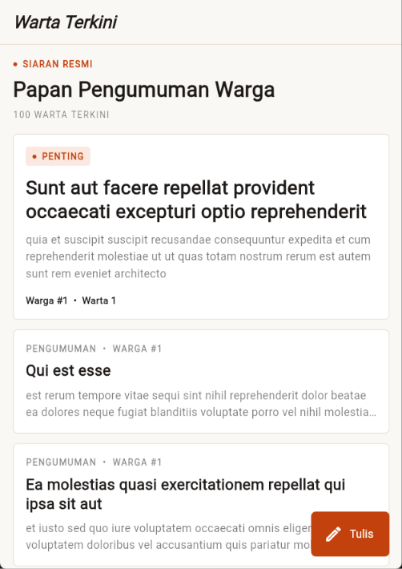
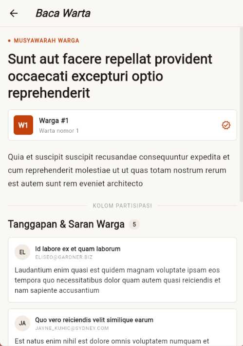
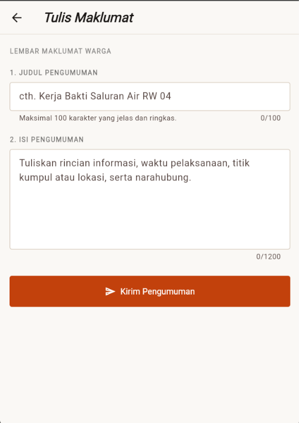
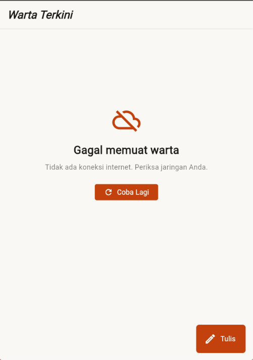
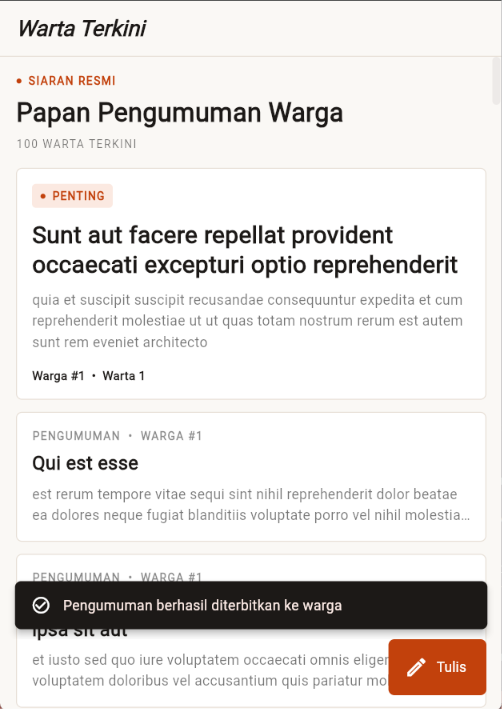

# NusaInfo

Aplikasi papan pengumuman warga berbasis Flutter. Data pengumuman diambil dari
[JSONPlaceholder](https://jsonplaceholder.typicode.com) menggunakan package `http`.
Tampilan mengikuti desain **Warm Editorial Craft** (kanvas kertas hangat, aksen
terracotta, heading serif).

## Identitas

- Nama: Muhammad Aldi Syamsul Anwar
- Kelas: TI24G

## Fitur

- Daftar pengumuman dari `GET /posts` (`FutureBuilder` + `ListView.builder`)
- Loading, pesan error, dan tombol **Coba Lagi**
- Tarik ke bawah untuk memuat ulang (`RefreshIndicator`)
- Detail pengumuman beserta komentar dari `GET /posts/{id}/comments`
- Form tambah pengumuman dengan validasi (`GlobalKey<FormState>`) dan
  `POST /posts` (`jsonEncode()`)
- `SnackBar` di Home setelah pengumuman berhasil dibuat (`await Navigator.push()`)

## Struktur Folder

```
lib/
├── models/
│   └── post.dart
├── services/
│   └── post_service.dart
├── screens/
│   ├── home_screen.dart
│   ├── detail_screen.dart
│   └── add_post_screen.dart
└── main.dart
```

## Cara Menjalankan

```bash
git clone https://github.com/<username>/nusa_info.git
cd nusa_info
flutter pub get
flutter run
```

Pastikan perangkat atau emulator memiliki koneksi internet.

## Screenshot

### Home Screen


### Detail Screen


### Add Post Screen


### Pesan Error saat Internet Mati


### SnackBar setelah Pengumuman Berhasil Dibuat


## Catatan

JSONPlaceholder hanya API simulasi. `POST /posts` mengembalikan respons sukses
(status 201) tetapi data tidak benar-benar disimpan, sehingga pengumuman baru
tidak muncul di daftar.